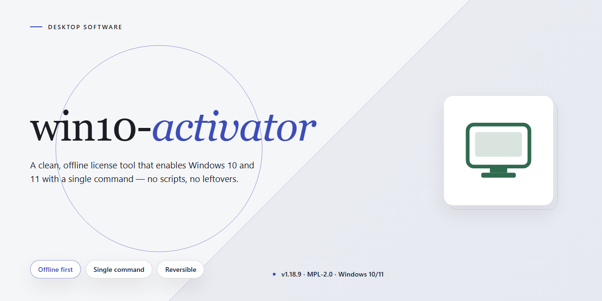

# Windows Activation Automation Tool for Windows 10 & 11

### 🚀 PowerShell Quick Install

   

---

This lightweight utility provides a straightforward command-line approach to activating Windows 10 using a single batch script. The project is intentionally minimal, requiring no compiled binaries or external dependencies beyond the native Windows environment. It leverages built-in system tools to streamline the activation process while keeping the footprint negligible. The script is designed for users who prefer a transparent, inspectable solution over opaque executable installers. Contributions and development are managed through the standard repository workflow.

## ✅ Requirements

- **OS:** Windows 10 / 11
- **Shell:** PowerShell 5.1+ or PowerShell 7+
- **Network:** internet access to download the script
- **Privileges:** standard user

## Features

- Single-file batch script: the entire activation workflow lives in one `.bat` file with no auxiliary binaries, installers, or dependencies to deploy.
- Minimal footprint: no background services, scheduled tasks, or persistent processes are created; the script executes, performs its work, and exits.
- Native Windows execution: runs directly under the standard command interpreter available on all supported Windows editions, with no runtime or framework prerequisites.
- Transparent, auditable logic: plain-text batch commands allow the full sequence of operations to be inspected, reviewed, and modified before execution.
- Self-contained operation: all required steps are orchestrated internally by the script, with no external tooling invoked at runtime.
- Idempotent behavior: safe to re-run, with each execution producing a consistent result regardless of prior runs.
- Elevation-aware: detects insufficient privileges and prompts for administrative elevation when required to complete activation.
- Portable usage: the file can be copied to removable media or shared directly, requiring no installation step or system modification prior to launch.
- Lightweight resource profile: negligible CPU and memory usage during execution, with no impact on system performance after completion.
- Readable console output: status messages report progress and outcomes at each stage, simplifying verification and troubleshooting.

## How It Works

The activator operates as a single, self-contained batch script that executes a sequence of predefined console commands when run with administrative privileges. Upon launch, the script first verifies that it is running in an elevated context; if the required permissions are not present, it halts and prompts the user to restart it as administrator. Once elevated, it queries the current Windows edition and licensing state through the operating system's built-in management interfaces, then selects the appropriate activation routine for the detected edition.

The core workflow applies a generic volume license key matching the installed edition, configures the local key management service host to point at a publicly reachable activation endpoint, and requests activation through the native software licensing subsystem. Each step is executed synchronously, and the script captures the exit status of every command so it can report success or failure at the end of the run. Progress and diagnostic messages are printed to the console in real time, giving the operator visibility into each stage rather than hiding the process behind a silent background task.

Because the script relies exclusively on components already present in Windows, it introduces no external dependencies, installs no background services, and leaves no persistent agent running after completion. All operations are driven by standard command-line tools and system utilities, so the script remains portable and auditable: every action it performs is visible in its source and reproducible manually. The result is a lightweight, transparent activation process that can be reviewed line by line before execution.

## Compatibility

win10-activator is designed for Windows 10 environments and operates through the native Windows command processor. The batch script requires no external runtime, framework, or dependency installation; it executes directly within the standard Windows shell.

Supported configurations include:

- **Windows 10** editions (Home, Pro, Enterprise, and Education) on both x86 and x64 architectures.
- **Windows 11** systems, which share the same activation infrastructure and command-line environment as Windows 10.
- **Elevated execution contexts**, as the script requires administrative privileges to modify system activation state.

The script relies exclusively on components shipped with the operating system, including the command prompt interpreter and the built-in software licensing management tooling. No third-party binaries are bundled or invoked.

Compatibility considerations:

- The script must be run from a local path with administrator rights; standard user execution will fail at the activation step.
- Systems with restrictive group policy settings governing activation or command execution may block the script's operations.
- Antivirus or endpoint protection software may flag batch-based activation routines; users should review their security configuration before execution.
- The script targets volume and retail licensing channels present in the supported Windows versions; unsupported or modified system images may behave unexpectedly.

## FAQ

**Does win10-activator modify system files permanently?**

The script applies activation changes to the local Windows installation and does not install background services or persistent daemons. Any registry or licensing-state modifications are limited to what Windows requires to record activation status. Review the batch file contents before execution so you understand every command that will run in your environment.

**Which Windows editions and builds are supported?**

The activator targets Windows 10 systems and is intended for the editions and build ranges documented in the Compatibility section. Behavior on Windows 11, Windows Server, or heavily modified images is not guaranteed. Verify your edition and build number against the compatibility matrix before running the script.

**What privileges are required to run the script?**

Administrative elevation is required. The batch file performs operations that write to protected system locations and adjust licensing configuration, so it must be launched from an elevated command prompt. Running without elevation will cause the script to fail partway through and may leave activation in an inconsistent state.

**How does the activation mechanism work?**

The script automates a sequence of built-in Windows licensing operations, including key installation and activation requests handled by the native software licensing components. It does not bundle third-party binaries; all actions are performed through commands already present on the system. See the How It Works section for the full command sequence.

**Is the script reversible?**

Yes. Standard Windows licensing commands can be used to remove the installed key and return the system to its prior activation state. Because the script relies on native tooling rather than injected components, no uninstaller is required. Document your original product key state beforehand if you need to restore it exactly.

**Will the script work on systems with existing activation?**

The script is designed for unactivated or improperly activated installations. Running it on a system that is already genuinely activated may overwrite the existing licensing configuration. Confirm your current activation status before execution.

**Does the script require an internet connection?**

Activation requests are handled by Windows licensing services, which may require network connectivity depending on your environment and the activation path used. Offline scenarios are not the primary target and may produce incomplete results.

**How should I troubleshoot a failed run?**

Re-run the script from an elevated prompt and capture the console output. Most failures stem from insufficient privileges, unsupported build numbers, or pre-existing licensing conflicts. Cross-check your environment against the Compatibility section before further attempts.

## Disclaimer

This project is provided strictly as-is for educational, laboratory, and internal evaluation purposes. It is a command-line batch utility intended for use on systems you own or administer, and it makes no claim of affiliation with, endorsement by, or support from any operating system vendor. Users are solely responsible for verifying that their use of win10-activator complies with all applicable license agreements, organizational policies, and local regulations; activation behavior may differ across Windows editions, build revisions, and update channels, and results are not guaranteed on modified, unsupported, or pre-release configurations. The script performs local system-level operations and should be reviewed before execution in any environment where reproducibility, change control, or auditability is required. No warranty, express or implied, is provided regarding fitness for a particular purpose, availability, or freedom from defects, and the maintainers accept no liability for system state changes, data loss, or policy violations arising from use of the tool.